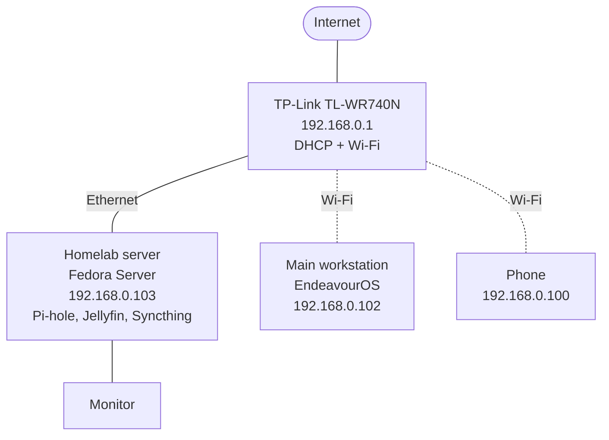

# Network Setup & Pi-hole: Fixed IPs and Network-wide Ad Blocking

Giving every device in the homelab a **stable address** and adding **Pi-hole** so the whole network gets DNS-level ad and tracker blocking.

| | |
|---|---|
| **Status** | Working (first results collected on 2026-11-25) |
| **Router** | TP-Link TL-WR740N (`192.168.0.1`) |
| **Pi-hole host** | Fedora Server, native install (no containers) |
| **Full details** | [network-pihole-setup.md](network-pihole-setup.md) |

---

## Why this matters

- **Services need an address that doesn't move.** SSH shortcuts, bookmarks, Jellyfin links, and the router's DNS setting all point at the server's IP. If the router hands out a different address after a reboot or lease renewal, everything breaks.
- **DNS is the phonebook of the network.** Every website, app, and tracker starts with a DNS lookup. Controlling DNS means controlling what the whole network can reach.
- **Visibility.** Pi-hole shows which device asks for which domain, which is a practical way to understand what your devices do in the background.
- **Real SysAdmin skills.** DHCP, address reservation, DNS, firewalls, and SELinux are everyday topics on Linux servers.

---

## What it does

**1. DHCP address reservation**
The router still hands out addresses automatically (DHCP), but it always gives the same address to a device it recognizes by its MAC address. The result is a fixed IP without configuring each device by hand.

**2. Pi-hole (DNS sinkhole)**
Pi-hole runs on the server and answers DNS queries for the network. When a device asks for a domain on a blocklist (ads, trackers), Pi-hole refuses to resolve it, so the ad or tracker never loads. Everything else is forwarded to an upstream DNS server.

```text
Device ──DHCP──▶ Router: "your IP is 192.168.0.x, your DNS server is 192.168.0.103"
Device ──DNS───▶ Pi-hole ──▶ blocked domain?  yes: no answer   no: ask upstream DNS
```

---

## Network diagram



| Device | Connection | Reserved IP | MAC (masked) |
|---|---|---|---|
| Router TP-Link TL-WR740N | - | `192.168.0.1` | - |
| Homelab server | Ethernet | `192.168.0.103` | `A0-B3-CC-xx-xx-xx` |
| Main workstation | Wi-Fi | `192.168.0.102` | `A8-6D-AA-xx-xx-xx` |
| Phone | Wi-Fi | `192.168.0.100` | `0A-D6-15-xx-xx-xx` |

DHCP pool: `192.168.0.100` - `192.168.0.199`, lease time 120 minutes.

---

## How each device got a fixed IP

I used **address reservation** on the router instead of configuring a static IP on every device. One place controls all addresses, and Pi-hole's documentation says a DHCP reservation is enough for its static-IP requirement.

1. Find the device's MAC address (on Linux: `ip -br link`).
2. In the router: **DHCP → Address Reservation → Add New**.
3. Enter the MAC address and the IP address, set the status to **Enabled**, and **Save**.
4. Reboot the router if asked (its help page says the changes apply after a reboot), then reconnect the device so it renews its lease.
5. Check **DHCP → DHCP Client List** to confirm the device received the reserved address.

Three reservations are in place (server, workstation, phone). More detail and the exact router settings are in [network-pihole-setup.md](network-pihole-setup.md).

---

## Pi-hole

Pi-hole is installed **natively on the Fedora server** (no Docker or containers), with SELinux kept in enforcing mode. The router's DHCP settings now tell devices to use it:

| Router DHCP setting | Value |
|---|---|
| Primary DNS | `192.168.0.103` (the server) |
| Secondary DNS | `0.0.0.0` (empty, so devices can't bypass Pi-hole) |

### First results (2026-11-25, shortly after the switch)

| Metric | Value |
|---|---|
| Total queries | 291 |
| Queries blocked | 15 (5.2 %) |
| Domains on blocklists | 81,677 |
| Clients using Pi-hole | phone (143 queries), workstation (128), server (20) |

The blocked queries came from the phone and were mostly app telemetry, for example Firebase logging and app measurement domains.

### Things to know

- **Not every ad is blocked.** DNS blocking can't stop ads served from the same domain as the content (YouTube, for example).
- **Some devices can bypass it.** Phones with "Private DNS" and browsers with "Secure DNS / DNS over HTTPS" use their own resolver.
- **If the server is off, name resolution stops** for devices that use it, because the secondary DNS is empty.
- **Rollback:** clear the Primary DNS field in the router, save, and reconnect devices.

See [network-pihole-setup.md](network-pihole-setup.md) for the install steps, the problems I hit and how I fixed them, and what is still untested.
