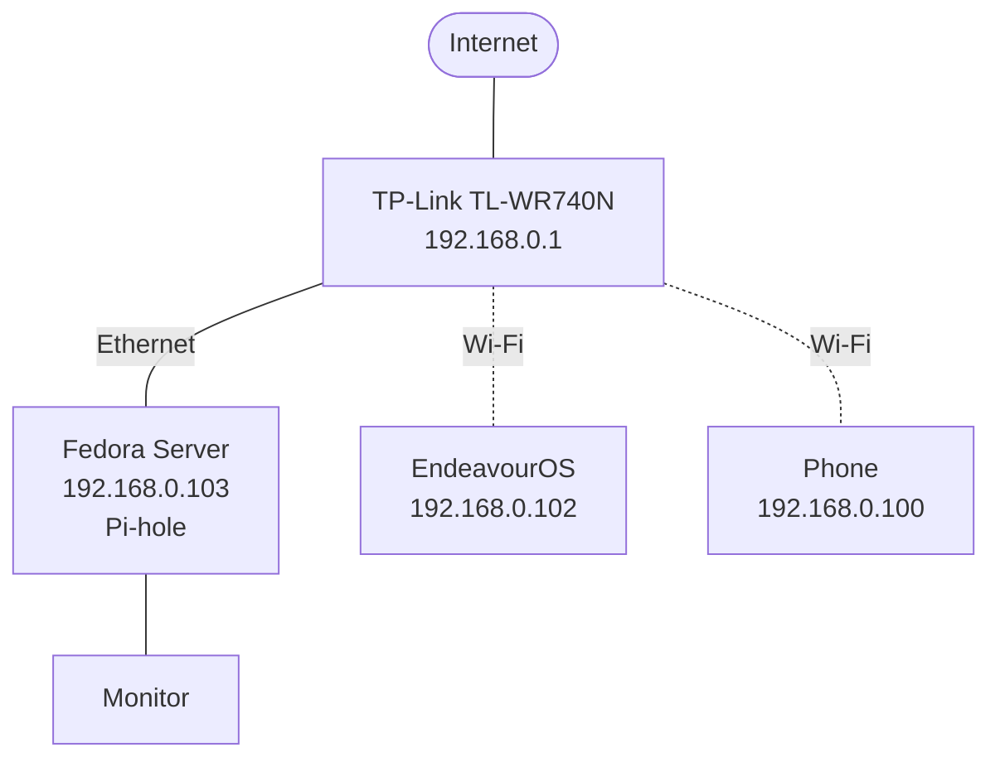

# Project: Fixed IPs and Pi-hole on the Homelab Network

## 1. Objective

1. Give each important device a stable IP address using DHCP reservations on the TP-Link router.
2. Install Pi-hole natively on the Fedora server and make the whole network use it for DNS.
3. Understand what happens underneath: DHCP, DNS, firewalld, and SELinux.

## 2. Environment

| Component | Details |
|---|---|
| Router | TP-Link TL-WR740N, `192.168.0.1`, DHCP server enabled |
| Homelab server | Fedora Server, wired (Ethernet), reserved `192.168.0.103` |
| Main workstation | EndeavourOS, Wi-Fi, reserved `192.168.0.102` |
| Phone | Wi-Fi, reserved `192.168.0.100` |
| Pi-hole | Native install on the Fedora server, web interface on port 80 |

Router DHCP settings (from the router's DHCP Settings page):

| Setting | Value |
|---|---|
| DHCP server | Enabled |
| Start / End IP | `192.168.0.100` / `192.168.0.199` |
| Address lease time | 120 minutes |
| Default gateway | `192.168.0.1` |
| Primary DNS | `192.168.0.103` (Pi-hole) |
| Secondary DNS | `0.0.0.0` |



## 3. Part 1: DHCP address reservation

### Why reservation instead of a static IP on each device

- One place (the router) controls every address.
- Devices keep using DHCP, so DNS settings from the router still reach them.
- Pi-hole's documentation says a DHCP reservation satisfies its static-IP requirement.

### Steps

1. Find the MAC address of each device. On a Linux machine:
   ```bash
   ip -br link
   ```
   Use the **wired** card's MAC for the server, since it is connected by Ethernet. The Pi-hole "Network" page later confirmed the server's MAC vendor as Hewlett Packard.
2. Open the router at `http://192.168.0.1` and go to **DHCP → DHCP Client List** to see the current addresses.
3. Go to **DHCP → Address Reservation → Add New** and enter the MAC and the IP.
4. Set the status to **Enabled** and **Save**. The router's help text says changes take effect after the router reboots.
5. Reconnect the device (or renew its lease), then check the client list again.

### Result

| ID | Device | MAC (masked) | Reserved IP | Status |
|---|---|---|---|---|
| 1 | Homelab server | `A0-B3-CC-xx-xx-xx` | `192.168.0.103` | Enabled |
| 2 | Phone | `0A-D6-15-xx-xx-xx` | `192.168.0.100` | Enabled |
| 3 | Main workstation | `A8-6D-AA-xx-xx-xx` | `192.168.0.102` | Enabled |

Notes:
- I reserved the addresses the devices already had, which sit inside the DHCP pool (`.100` to `.199`). The router maps each MAC to its address, so no other device receives it.
- The workstation appeared earlier with a second MAC (a second network card). Only one of them is reserved. If I connect both cards at the same time, the second one will get a normal dynamic address.
- The phone uses a randomized (private) MAC address. If I reset the phone's Wi-Fi privacy setting for this network, its MAC changes and the reservation stops matching.

## 4. Part 2: Installing Pi-hole natively on Fedora Server

### Preparation

- The server already has its reserved IP (Part 1).
- Pi-hole's documentation lists Fedora as officially supported (actively maintained versions only), with a minimum of 512 MB RAM and 2 GB of free space. The server has about 5.4 GiB of RAM.
- Port 53 (DNS) and ports 80/443 (web interface) must be free.

### Installation

Run on the **server** (check the hostname first):

```bash
hostnamectl
wget -O basic-install.sh https://install.pi-hole.net
less basic-install.sh
sudo TERM=xterm-256color PIHOLE_SELINUX=true bash basic-install.sh
```

- `less` lets me read the script before running it.
- `PIHOLE_SELINUX=true` tells the installer to continue even though SELinux is enforcing. It does not disable SELinux.
- `TERM=xterm-256color` avoids an ncurses error caused by the kitty terminal (see the problem table).

Installer choices: wired interface (`eno1`), the default blocklist, the web interface enabled. The dashboard's upstream chart shows `dns.google#53`, so the upstream DNS is Google.

### After the install

```bash
sudo pihole setpassword
systemctl status pihole-FTL
sudo firewall-cmd --permanent --add-service=dns --add-service=http --add-service=https
sudo firewall-cmd --reload
```

The dashboard opens at `http://192.168.0.103/admin` from the workstation, and DNS queries from other devices are answered, so the DNS and HTTP ports are reachable on the LAN.

## 5. Part 3: Making the network use Pi-hole

Before changing the router, I tested from one device. Then in the router: **DHCP → DHCP Settings**:

- Primary DNS: `192.168.0.103`
- Secondary DNS: `0.0.0.0`

Why the secondary is empty: many devices query both DNS servers or fall back to the second one, so a public DNS there would let some queries skip Pi-hole. The trade-off is that DNS stops whenever the server is down.

Devices pick up the new DNS when their lease renews (120 minutes) or when they reconnect.

## 6. Verification and results

Pi-hole dashboard shortly after the switch (2026-11-25):

| Metric | Value |
|---|---|
| Status | Active |
| Total queries | 291 |
| Queries blocked | 15 |
| Percentage blocked | 5.2 % |
| Domains on lists | 81,677 |
| Active clients | 4 (including localhost) |

Network overview (clients using Pi-hole):

| Client | Queries |
|---|---|
| `192.168.0.100` (phone) | 143 |
| `192.168.0.102` (workstation) | 128 |
| `192.168.0.103` (server) | 20 |
| localhost | 6 |

The blocked queries in the query log all came from `192.168.0.100`: `firebaselogging.googleapis.com`, `app-measurement.com`, and `_dns.resolver.arpa` (SVCB). The phone's app telemetry is now blocked at the DNS level.

Commands to repeat the checks:

```bash
dig doubleclick.net                 # a blocked domain should not return a real address
dig google.com @192.168.0.103       # normal domains still resolve
nmcli dev show | grep DNS           # the DNS server should be 192.168.0.103
```

## 7. Problems and fixes

| Symptom | Cause | Fix |
|---|---|---|
| Installer exits with "SELinux Enforcing detected" | Pi-hole ships no SELinux policy, so the script stops when SELinux is enforcing | Run with `sudo PIHOLE_SELINUX=true`, keep SELinux enforcing, then check for AVC denials |
| "No supported package manager found" | I ran the installer on the EndeavourOS workstation (pacman), which Pi-hole doesn't support | Run it on the Fedora server over SSH; check the hostname before installing |
| `ncurses: cannot initialize terminal type ($TERM="xterm-kitty")` | The server has no terminfo entry for the kitty terminal | `TERM=xterm-256color` for the session, or `sudo dnf install kitty-terminfo` |
| Devices still show ads or never appear in the query log | They use a secondary DNS, Private DNS, or DNS over HTTPS | Keep the router's secondary DNS empty and disable Private DNS or Secure DNS on the device |

## 8. Security notes

- SELinux: the installer reported enforcing mode. **TODO:** record the output of `getenforce` and `sudo ausearch -m avc -ts recent` after the install (any denials, and how I handled them).
- The Pi-hole admin password is set, and the dashboard is only reachable inside the LAN.
- No port forwarding or UPnP is configured on the router for this project.
- Change the router's admin password if it is still the default.

## 9. Not tested yet

- [ ] Reboot test: does `pihole-FTL` start by itself? (`systemctl is-enabled pihole-FTL`)
- [ ] Failure test: stop `pihole-FTL` and record exactly what the network does, and how long recovery takes.
- [ ] SELinux check after install (`getenforce`, `ausearch`).
- [ ] Router reboot test: do all three reservations survive?
- [ ] Which devices bypass Pi-hole (TV, other phones)?
- [ ] Back up the Pi-hole configuration (Settings → Teleporter).
- [ ] Add an allowlist entry for a site that breaks, and document it.

## 10. What I learned

1. A DHCP reservation gives the benefits of a static IP while keeping one control point.
2. DNS is a single point of failure: when it moves to the server, the server's uptime matters for the whole network.
3. DNS blocking is useful but partial: it stops telemetry and many ads, not ads served from the content's own domain.
4. Reading an installer's error message carefully (SELinux, package manager, terminal type) leads straight to the cause.
5. Always check which machine I'm on before running an installer.

## 11. Screenshots to add

Put these in a `screenshots/` folder, and **hide MAC addresses and the router's address-bar path (it contains a session token) before publishing**:

- `router-dhcp-settings.png` (DHCP Settings with Primary and Secondary DNS)
- `router-address-reservation.png`
- `pihole-dashboard.png`
- `pihole-blocked-queries.png`
- `pihole-network-overview.png`

## 12. Next improvements

- Add a second DNS resolver so the network keeps working while the server reboots.
- Use Unbound as Pi-hole's upstream instead of Google DNS.
- Monitor the server (Cockpit, disk health) and set up automated backups with `restic`.
